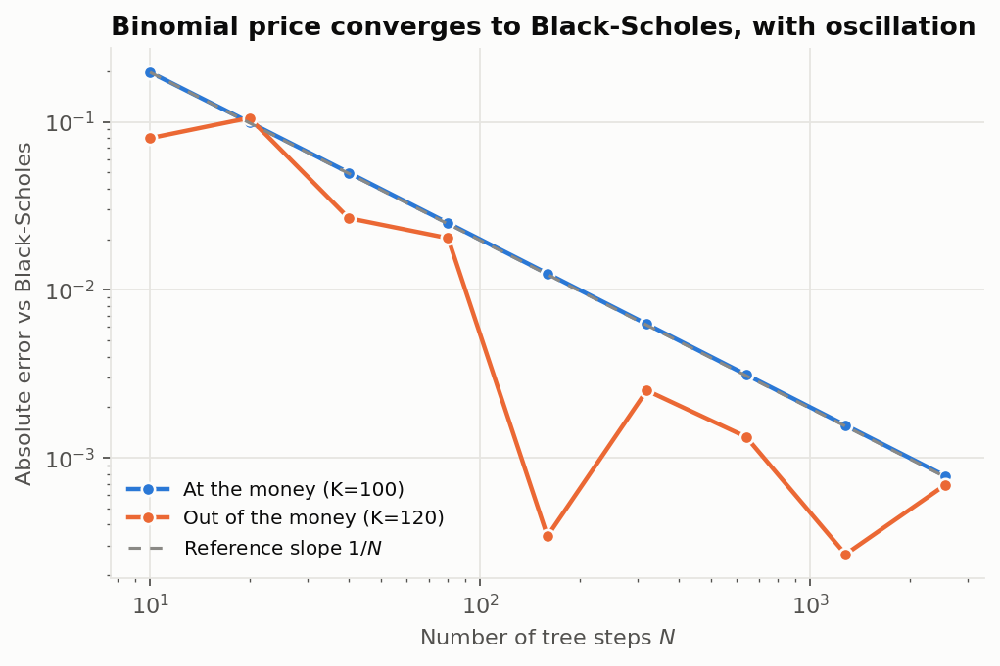
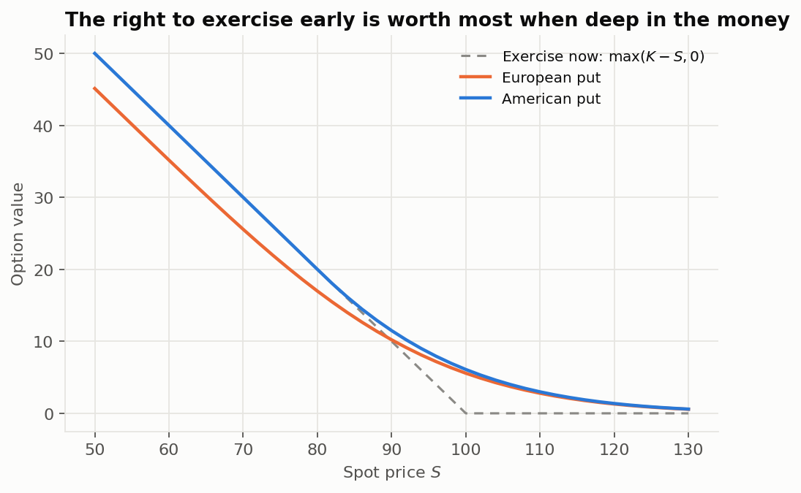
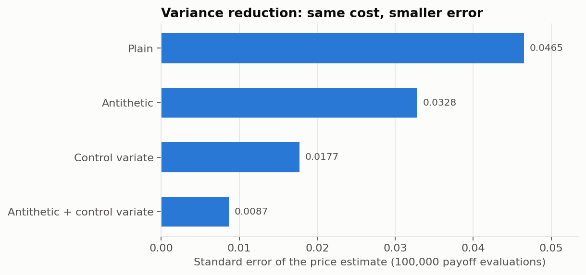
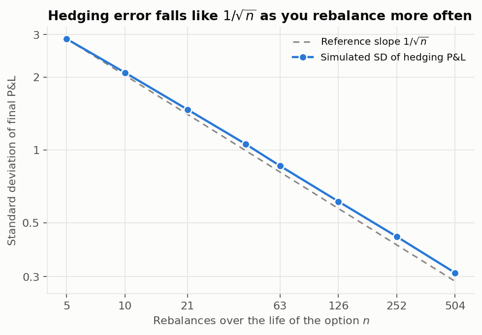
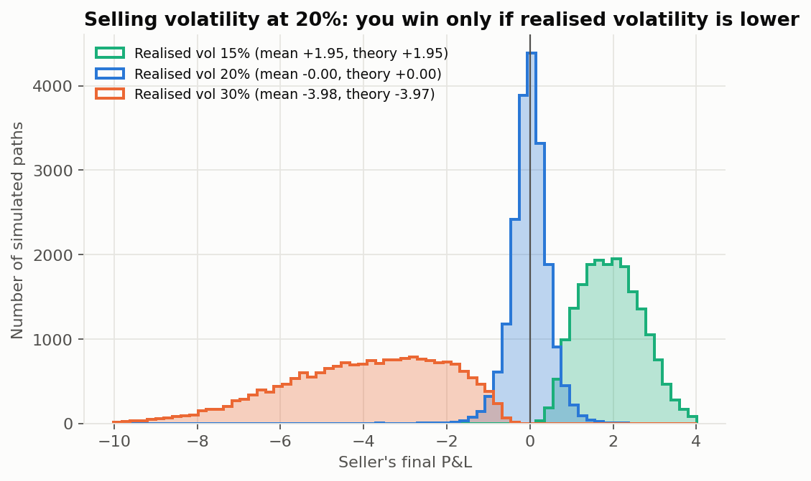
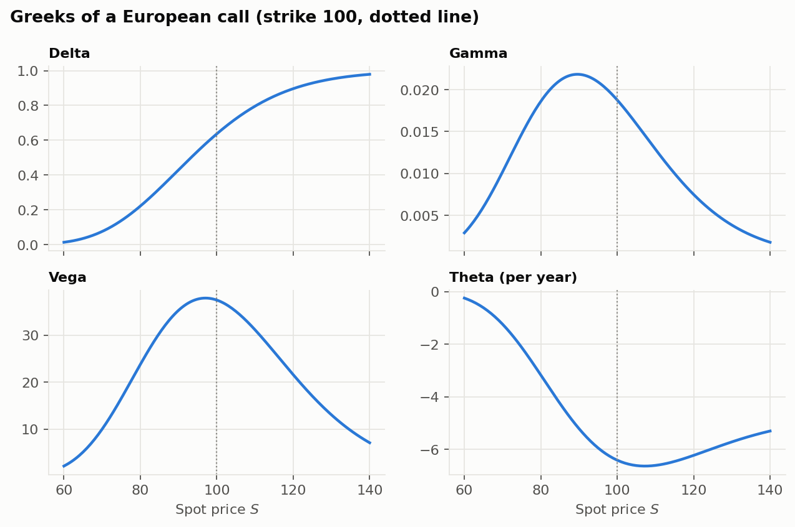

# Options Pricing Lab

Four ways to price a European option, an American-option pricer, and a delta-hedging simulator, each checked against the others and against theory.

| Part | File | What it does |
|---|---|---|
| Black–Scholes | `src/black_scholes.py` | Closed-form price, Greeks, and implied volatility (with no-arbitrage checks). |
| Binomial tree | `src/binomial.py` | Cox–Ross–Rubinstein tree, European and American. |
| Monte Carlo | `src/monte_carlo.py` | Plain, antithetic and control-variate pricing; pathwise delta. |
| Delta hedging | `src/hedging.py` | Simulates a seller who delta-hedges at discrete times; includes a closed-form check for the volatility-mismatch case. |
| Experiments | `main.py` | Writes `results/tables/*.csv`, `run_summary.json` and six figures. |
| Tests | `tests/` | 193 tests (175 pass, 18 skipped by design). |

**Scope:** simulated market, no dividends, constant volatility and rate, no transaction costs, no real data. This is a study of pricing and hedging mechanics, not a trading strategy.

## Run it
```bash
pip install -r requirements.txt
python -m pytest -q      # ~3 s
python main.py           # ~10 s, deterministic for a given --seed (default 42)
```
Two runs with the same seed give a byte-identical `run_summary.json`.

## Results (S = K = 100, r = 5%, σ = 20%, T = 1 year, seed 42)

**Black–Scholes:** call 10.4506, put 5.5735, put–call parity holds to machine precision; implied volatility recovers σ = 0.2000000000 from the call price.

**Binomial tree:** at-the-money error shrinks like 1/N (7.8e-4 at N = 2560). Out-of-the-money options oscillate around the exact value as N grows, a known feature of the tree. The American put at the money is worth 6.090 against 5.573 European, an early-exercise premium of about 0.52.




**Monte Carlo (100,000 payoff evaluations, SE averaged over 20 seeds):**

| Method | Standard error | Variance vs plain |
|---|---|---|
| Plain | 0.0465 | 1.00 |
| Antithetic | 0.0328 | 0.50 |
| Control variate | 0.0177 | 0.15 |
| Both | 0.0087 | 0.035 |

All four methods agree with Black–Scholes within their error bars. Their 95% confidence intervals contain the true price 94.5–95.3% of the time over 2,000 repetitions each (sampling noise on that figure is about ±0.5 percentage points). Pathwise delta matches analytic delta for six strikes/types (all |z| < 0.8).



**Delta hedging a sold at-the-money call (20,000 paths per setting):**
- With volatility sold = volatility realised, the mean P&L is zero within error and the standard deviation falls from 2.88 (5 rebalances) to 0.31 (504). The fitted log–log slope is −0.48, close to the −0.5 that theory predicts. For comparison, not hedging at all gives a standard deviation of 15.8.
- If you sell volatility at 20% and the market realises something else, your expected P&L is

$$
\mathbb{E}[\text{P\&L}] = \tfrac12\,(\sigma_{\text{imp}}^2-\sigma_{\text{real}}^2)\int_0^T e^{r(T-t)}\,\mathbb{E}\!\left[S_t^2\,\Gamma_{\text{imp}}(t,S_t)\right]dt .
$$

  I evaluate this numerically and compare it with the simulation (daily hedging):

| Realised vol | Simulated mean P&L | Theory (continuous hedging) |
|---|---|---|
| 10% | +3.828 | +3.833 |
| 15% | +1.951 | +1.954 |
| 20% | −0.003 | 0.000 |
| 25% | −1.987 | −1.982 |
| 30% | −3.978 | −3.975 |

  The simulation sits about 0.004 below theory in every row. That small, consistent gap is most likely discretisation bias from hedging daily rather than continuously; I did not isolate it further. The five rows reuse the same random draws, so their agreement is one piece of evidence, not five.





## How it is tested
- Textbook reference values, put–call parity, and Greeks against finite differences.
- Implied volatility round-trips across strikes, maturities and volatilities; prices outside the no-arbitrage range raise an error instead of returning a number. 18 round-trip cases are skipped because the option's price equals its intrinsic value to machine precision, so the volatility cannot be recovered.
- A one-step tree computed by hand; American call (no dividends) equals European; American put is never below the European put or intrinsic value.
- Monte Carlo is within 4 standard errors of Black–Scholes for every method and its confidence-interval coverage is checked; variance-reduction claims are tested.
- Hedging: zero mean and $1/\sqrt{n}$ error scaling when volatilities match; theory vs simulation when they don't.

## Limitations
- Black–Scholes assumptions: constant volatility, no jumps, no dividends, no transaction costs, continuous trading in the model but discrete in the simulation. Real markets violate all of these (volatility smiles, gaps, bid–ask spreads).
- The American put is priced on a tree; I did not implement a finite-difference or least-squares Monte Carlo alternative.
- The mismatch theory assumes the stock drifts at the risk-free rate; a different real-world drift changes the expected P&L.
- No real market data is used, so no volatility smile is fitted. I chose not to fit a smile to synthetic quotes, because recovering a smile I generated myself would be circular.
- Single-asset, single-option setting only.

## Layout
```
src/                 pricers, hedging simulator, plots
tests/               193 tests
main.py              all experiments
results/             figures/ and tables/ written by main.py
PROJECT_NOTES.md     the maths and interview-style derivations
LEARNING_ROADMAP.md
```


## Repository and licensing

- The committed `results/` files are example outputs from the documented seed; rerun `python main.py` to regenerate them.
- GitHub Actions runs the test suite on pushes and pull requests.
- **No license is included yet.** Before publishing, choose a license that matches how you want others to use, modify, and redistribute this project. Without a license, public visibility alone does not grant those permissions.
